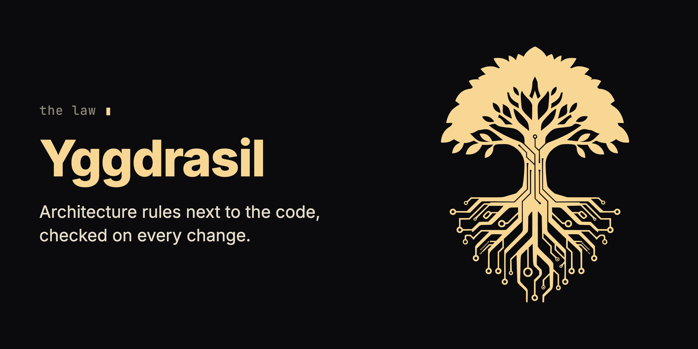

<p align="center"></p>

<div align="center">


# Yggdrasil

**Say it once.**

Yggdrasil keeps your architecture rules in a folder next to your code and checks every change against them.

[](https://www.npmjs.com/package/@chrisdudek/yg) [](https://github.com/krzysztofdudek/Yggdrasil/actions/workflows/ci.yml)

[What you install](#what-you-install) · [Start](#start) · [Remove it](#remove-it) · [Docs](https://krzysztofdudek.github.io/Yggdrasil/)

</div>

You tell your coding agent a rule, and a few sessions later it breaks it. The rule sits in a prompt file that nothing checks, so the only check between the agent's code and `main` is you.

## What you install

```bash
npm install -g @chrisdudek/yg
cd your-project
yg init
```

Requires Node.js 22 or newer. `yg init` asks one question: which reviewer judges the rules that need judgment. "None for now" is a valid answer.

| Piece | Where it lands | What it does | When it acts |
|---|---|---|---|
| The `yg` command | your global npm packages | Reads the graph, gives the agent its rules, runs the checks. | When you, the agent, a hook or CI call it. |
| `.yggdrasil/` | repository root, committed | Holds the graph of your components, the rules, the logs of why, and the lock with every recorded verdict. | Read by every `yg` command. |
| `.yggdrasil/.gitignore` | inside `.yggdrasil/`, committed | Keeps the local cache and local state out of git. | On every commit. |
| Agent rules | a block in `AGENTS.md`, one import line in `CLAUDE.md`, `.clinerules/yggdrasil.md` | Tells the agent to run `yg context --file` before it edits a file and `yg check --approve` after a change. | Every agent session that reads those files. |
| Eight lines in `.gitattributes` | repository root, committed | Mark the lock as generated and name the merge drivers for the logs and the lock. | On `git diff` and `git merge`. |
| Two merge drivers | `.git/config` of this clone, never committed | Merge log entries and verdicts from two branches without a hand-resolved conflict. | On `git merge`. |
| A `post-merge` hook | `.git/hooks/post-merge` of this clone, only when you have none | Records the merged logs' baselines. | After `git merge`. |

- **Does not touch:** `yg init` does not edit your source files, your build or your runtime; it writes the files in the table above. It installs no pre-commit hook and no CI step; you add those yourself (step 5 of [Start](#start)).
- **Needs:** Node.js 22 or newer. A reviewer only for rules a script cannot decide: Claude Code, Codex, Gemini CLI or Copilot CLI with no key, Anthropic, OpenAI or Google with a key, Ollama on your machine, or any OpenAI-compatible endpoint.
- **Costs:** script rules, dependency checks, a plain `yg check` and the CI gate are free, local and need no key or network. A reviewer rule costs one model call per rule and component when it is first judged, and again only after its inputs change. One call takes roughly 10 to 40 seconds. `yg check --approve --dry-run` tells you how many paid calls a run will make before it makes them.
- **In the agent's context:** the rules block in `AGENTS.md`, and for each file the agent edits, the rules in force on that file only.

<details>
<summary>What the words in the reports mean</summary>

A rule is an *aspect*, a component is a *node*, and a *pair* is one rule on one component or file. The *graph* is the map of components and rules in `.yggdrasil/`, a *verdict* is the recorded pass or refusal of one pair, and the *lock* is the file that holds the verdicts. The full list is in the [glossary](https://krzysztofdudek.github.io/Yggdrasil/glossary).

</details>

## What changes on the first day

- Before it edits a file, the agent runs `yg context --file <path>` and gets the rules on that file, not the whole rulebook.
- After a change, the agent runs `yg check --approve` and fixes a refusal before it moves on.
- A change to `.yggdrasil/yg-architecture.yaml` is a proposal the agent asks you to confirm.
- You decide which rules matter; the agent writes them into `.yggdrasil/`.
- Your pre-commit hook and CI fail a change that breaks a rule, or whose recorded verdict no longer matches the code.

The first two lines are instructions the agent follows. The hook and CI in the last line are what nobody can talk past.

## Start

### 1. Try it without touching your own repository

```bash
git clone --depth 1 https://github.com/krzysztofdudek/Yggdrasil
cd Yggdrasil/examples/layered-architecture
```

In `src/web/rideHandler.ts`, add `import { findRide } from '../data/rideRepository.js';` under the existing import, then run `npx @chrisdudek/yg@6.1.0 check`.

You see:

```text
yg check: FAIL  1 error   3 nodes · 3/3 files covered · 5 excluded

error[relation-undeclared-dependency] Node 'web' has undeclared dependencies on other nodes
  at:   web
          src/web/rideHandler.ts:5 → data
  why:  A dependency on another component must be a sanctioned, declared relation. Undeclared edges erode the architecture allow-list of who may depend on whom.
  fix:  No relation can be declared for this dependency: remove it, or ask the user to approve an architecture change:
        data: no relation type is allowed from handler to repository that sanctions an import (only uses, calls, extends and implements do), so none can be declared. Remove the dependency, or ask the user to approve an architecture change — a different node type, or a new allowed relation in .yggdrasil/yg-architecture.yaml.

next: edit src/web/rideHandler.ts:5
```

No model was asked.

### 2. Run the example with a recorded verdict

Run `cd ../failing`, then `npx @chrisdudek/yg@6.1.0 check`.

You see:

```text
yg check: FAIL  1 error   2 nodes · 3/3 files covered · 4 excluded

error[refused] requires-audit — refused on payments
  at:   payments  Both mutation functions in src/payments.ts violate the requirement: charge (line 5) and refund (line 11) mutate state but use only generic console.log() calls instead of calling emitAudit(). The aspect requires structured audit events with operation, timestamp, and entityId fields. No suppression markers found.
  why:  Every mutation must emit an audit event
  fix:  Four exits — the verdict is recorded for this exact code, so re-running the reviewer changes nothing:
```

(Trimmed; the full report lists the four exits.) That is a model's verdict, recorded once in the lock and replayed with no model call. Change `src/payments.ts` by one character and check again:

```text
yg check: FAIL  1 error   2 nodes · 3/3 files covered · 4 excluded

error[unverified] 1 pair whose inputs changed since the verdict
  at:   requires-audit @ payments
  why:  A verdict was recorded, but its inputs changed since (a source edit, an aspect edit, or a changed reference), so it no longer counts. It is re-judged over the code as it stands now.
  fix:  yg check --approve  (1 reviewer pair · 1 call · paid)
```

### 3. Install it in your own repository

Run the three install commands above.

You see: the reviewer question, then the files from the table written.

### 4. Ask for your first rule

Run `yg check`, then tell your agent: "The API layer must never import the database module. Enforce it."

You see: the first `yg check` is green with one `uncovered` warning, a to-do rather than a failure. The agent proposes two component types with no allowed dependency between them and asks you to confirm. If your code already crosses that line, the next `yg check` fails:

```text
yg check: FAIL  1 error   2 nodes · 2/2 files covered · 4 excluded

error[relation-undeclared-dependency] Node 'api' has undeclared dependencies on other nodes
  at:   api
          src/api/orders.ts:1 → db
```

(Trimmed.) That check is free and needs no key.

### 5. Put the gate where it cannot be skipped

Point your pre-commit hook at `yg check`, and add these two lines to CI:

```yaml
- run: npx @chrisdudek/yg@6.1.0 check --approve --only-deterministic
- run: npx @chrisdudek/yg@6.1.0 check --no-approve
```

You see: the job fails on any rule a change breaks and on any verdict that no longer matches the code, with no key and no model call. On pull requests from forks, run only the second line ([why](https://krzysztofdudek.github.io/Yggdrasil/the-lock#what-yg-check-proves-and-against-whom)). Pin the version and raise the pin in a commit of its own.

Would you rather be taught? In a repository that has run `yg init`, tell your agent "onboard me into Yggdrasil". It teaches you on your own code, in your own language.

## What it does not do

- It checks structure, not runtime behaviour: it can require a call to the audit utility, and it cannot prove the audit fired in production.
- The dependency check sees static imports only; calls over HTTP, dependency injection, reflection and events are invisible to it.
- A green check is only as good as the rule behind it, and deciding what is worth enforcing stays with you.
- A reviewer is a model, and [its verdicts are not deterministic](https://krzysztofdudek.github.io/Yggdrasil/reviewers); start a reviewer rule as `advisory` and enforce it once it has earned your trust.
- A recorded pass stays a pass until the code or the rule changes, even after you switch the reviewer's model ([model-swap protocol](https://krzysztofdudek.github.io/Yggdrasil/model-swap-protocol)).
- A green `yg check` proves the verdicts match the code on disk, not that a reviewer produced them; the gate is as trustworthy as whoever can push to the branch.
- On an existing codebase, the first work is usually learning that the code does not match the architecture you thought you had ([Phase 0](https://krzysztofdudek.github.io/Yggdrasil/showcase#the-phase-0-reality), [progressive mode](https://krzysztofdudek.github.io/Yggdrasil/progressive-mode)).

## Questions

**How is this different from a rules file?** A rules file is flat text in every prompt, with no scope and no check. Here the agent gets only the rules on the file it is editing, and its change is checked against them.

**And from dependency-cruiser or ArchUnit?** For import rules in one language they are mature, and if that is all you need, use them. Yggdrasil's dependency check is one part of it: one graph across eleven languages, with script rules, reviewer rules and the lock beside it.

**And from an AI review bot?** A review bot looks for bugs against its own idea of good code and runs again on every pull request. Yggdrasil checks your team's rules and pays for a verdict once per version of the code it judged.

## Remove it

```bash
npm uninstall -g @chrisdudek/yg
```

Then delete `.yggdrasil/`, the Yggdrasil block in `AGENTS.md`, the import line in `CLAUDE.md`, `.clinerules/yggdrasil.md` and the eight Yggdrasil lines in `.gitattributes`. In each clone, also delete the two merge drivers in `.git/config` and the `post-merge` hook if `yg init` wrote it. Nothing in your build or runtime depends on any of it. Your reviewer rules are plain Markdown and go wherever you go; script rules are written against Yggdrasil's `check(ctx)` contract and need porting.

## Where it fits

Yggdrasil is the law of the family, and it depends on no other family tool: Horde requires it, and Grain and Jarl use it when it is there. It installs one library of the family's shared code, `@chrisdudek/runes`, at an exact version.

Read more: [Docs](https://krzysztofdudek.github.io/Yggdrasil/) · [How it works](https://krzysztofdudek.github.io/Yggdrasil/how-it-works) · [Rules](https://krzysztofdudek.github.io/Yggdrasil/aspects) · [The lock](https://krzysztofdudek.github.io/Yggdrasil/the-lock) · [CI integration](https://krzysztofdudek.github.io/Yggdrasil/getting-started#_5-ci-integration) · [Changelog](CHANGELOG.md) · [Contributing](CONTRIBUTING.md) · [Security](SECURITY.md) · [Report a problem](https://github.com/krzysztofdudek/Yggdrasil/issues)

## The Yggdrasil family

**[Jarl](https://github.com/krzysztofdudek/JarlSkill)** is the loop. **Yggdrasil** is the law. **[Grain](https://github.com/krzysztofdudek/Grain)** is the survey. **[Horde](https://github.com/krzysztofdudek/Horde)** plans the mission onto the law before anyone writes, lands every change through a gate no agent can argue with, and turns what the mission learned into law. It runs on Jarl's loop, with Grain in the architect's hands. Those four are the core, and they ship under one version number, Jarl on it from 6.1.0: one set of tools built and tested against each other. Yggdrasil, Grain and Jarl each work alone; Horde is the one built on the other three. Where a repository has a check, the check decides what lands, in a Horde mission and in a Jarl loop alike: a fresh reviewer can only stop a change, never make a failing check pass, and its word is recorded as testimony. A Jarl loop in a repository with no check lands on testimony alone, and says so. Law that stays inside one component is raised freely by the agent working it. Law or decisions that reach a whole type of code are shared vocabulary: the agent proposes them and they run as advice at once, and the client, the one person the whole system answers to, admits them in one batch when the work closes. Only the client lowers or vetoes law. The core's shared machine contracts are registered on [one page](https://krzysztofdudek.github.io/Yggdrasil/family-contracts).

Start at the step where it hurts.

| Where it hurts | Start with |
|---|---|
| More issues than one agent can hold in its head | **Jarl** |
| The agent keeps breaking what was agreed | **Yggdrasil** |
| Nobody knows what was agreed | **Grain**, which earns its keep the moment you are about to write law |
| A task too big for one head to plan up front, in a repository that already has law | **Horde** |

| Core | What it holds |
|---|---|
| **[Jarl](https://github.com/krzysztofdudek/JarlSkill)** | The loop. Everything seen becomes an issue, each issue gets one worker in its own worktree, nothing closes without evidence and a review, and no code closes without a fresh reviewer's word. Rulings keep their history, and a ruling about a whole type of code goes to the client in one batch when the loop closes. |
| **Yggdrasil** (this one) | The law. The architecture graph, the rules over it and the log of why, checked before the agent moves on and re-proved in CI without a key. A rule that reaches a whole type runs as advice until the client ratifies it. |
| **[Grain](https://github.com/krzysztofdudek/Grain)** | The survey. Mines a repository's own code and history into a first graph: components, dependencies, and the rules the code already keeps, each with the count of places that break it today; Yggdrasil accepts it with one command. It measures and never blocks. |
| **[Horde](https://github.com/krzysztofdudek/Horde)** | The mission on the law. A one-shot architect plans the whole mission onto the graph once, measuring with Grain; a worker per ticket in its own worktree; every change lands through a nine-item gate; what the mission learned becomes law. Its record is a Jarl loop. The client orders the mission and is the only one who can lower or veto a rule. |

Three add-ons attach to the agent rather than to the graph; each works alone, depends on nothing in the family and keeps its own version. Horde doesn't assume any of them is installed, since it carries its own minimum discipline in each role's law. It uses Ratatoskr, Urd and Researcher when they are, one sentence per row below.

| Add-on | Stage | What it makes the agent prove | In Horde's loop |
|---|---|---|---|
| **[Ratatoskr](https://github.com/krzysztofdudek/RatatoskrSkill)** | request → intent | Keeps the agent talking to you in plain words, not code, so you can follow what it's doing. | Keeps the client's plain-language registry open at both ends of a mission. |
| **[Urd](https://github.com/krzysztofdudek/UrdSkill)** | intent → code | When the spec is ambiguous, it consults the source of truth and asks, it doesn't guess. | The stop a worker hits before it guesses. |
| **[Researcher](https://github.com/krzysztofdudek/ResearcherSkill)** | code → measured result | Point it at a metric and it runs experiments, hypotheses kept and discarded. | Runs the retrospective's measurement. |

## License

MIT. Made by [Krzysztof Dudek](https://github.com/krzysztofdudek).
